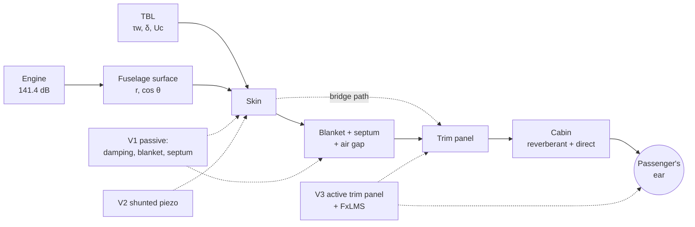

# Project Guide — cabinsim

This guide explains the EB205 cabin noise software from start to finish: how sound gets from the
engine to the passenger's ear, how the code calculates that path, and how much we can trust each
result. Every technical term is explained the first time it appears.

All numbers come from the default settings (`src/cabinsim/config/*.yaml`). You can get them again
with `python -m cabinsim.run`.

---

## 1. The big picture

### How the sound travels

The aircraft flies at 35 000 ft and Mach 0.85. A passenger sits in the VIP cabin, in the window seat
on the engine side. The sound at their ear comes from two main sources:

1. **The engine** (GE GEnx-1B): fan and jet noise travel through the air and hit the fuselage.
2. **The turbulent boundary layer (TBL)**: a thin layer of churning air right next to the outside of
   the fuselage. The swirls in it keep hitting the skin with small pressure kicks. Think of rain on
   a tin roof: the roof does not pass on each drop, but all the drops together make it shake.

Both sources make the **sidewall** (the fuselage wall) vibrate. From outside to inside, the sidewall is:

```
outside air | SKIN (carbon fibre, 4 mm) | BLANKET (glass wool) | (SEPTUM) | AIR GAP | TRIM PANEL | cabin
```

Sound gets through the wall in two ways:
- **Through the air (airborne path):** the skin shakes, pushes the air in the gap, and the air
  shakes the trim panel, which sends sound into the cabin.
- **Through the structure (bridge path):** skin → frames → the trim panel's mounting points
  (isolators) → trim panel. This path skips the blanket and the air gap.

Inside, the sound bounces off the walls (the **reverberant** field) and also comes straight from the
nearest panels (the **direct** field). The level at the ear is the sum of the two.

### Where our solutions act



| solution | what it adds | how it works |
|---|---|---|
| V0 baseline | — | A typical wall: 4 mm carbon-fibre skin, 75 mm Microlite blanket, 50 mm air, honeycomb trim |
| V1 passive | A damping layer on the skin (CLD), a thicker and denser blanket, a 1 kg/m² septum | Mass and damping: a heavier wall is harder to shake, and damping turns vibration into heat |
| V2 + piezo shunt | Piezo (PZT) patches on every skin bay, each wired to an RL circuit | The patch turns vibration into electricity; the tuned RL circuit turns that energy into heat in a resistor at one frequency. Like damping one note of a guitar string with your finger. |
| V3 + active trim | Piezo actuators on the trim panel, 4 microphones around the head, an FxLMS controller | The microphones hear the sound, the controller makes the panel play the opposite sound, and a small "quiet zone" forms around the head |

---

## 2. Folder and file map

```
Innovaero-EB205/
├─ pyproject.toml          package definition and dependencies (pip install -e .)
├─ README.md               installation (3 platforms), commands, demo
├─ src/cabinsim/           PHYSICS CORE (works without any user interface)
│  ├─ config/*.yaml        ALL NUMBERS: value + unit + [DOC]/[LIT]/[ASM] tag
│  ├─ params.py            reads the YAML files, keeps the tags separately
│  ├─ atmosphere.py        standard atmosphere: ρ, c, p, μ from altitude; cabin air; pressure difference Δp
│  ├─ metrics.py           adding decibels, A-weighting, SIL
│  ├─ source.py            splits the engine's sound power into bands and tones
│  ├─ geometry.py          cuts the fuselage into panels; distance r and cos θ for each panel
│  ├─ materials.py         plates (D, m''), Miki blanket model, piezo constants
│  ├─ tbl.py               Goody spectrum, Corcos/Mellen wavenumber spectrum
│  ├─ sidewall/
│  │  ├─ closed_form.py    the formulas from the team archive: c_L, f_r, f_c, f11, TL0, f0
│  │  ├─ tmm.py            transfer matrix method (sound through the wall layer by layer)
│  │  ├─ radiation.py      how well a panel of finite size sends out sound ("windowing")
│  │  ├─ bridge.py         bridge path (Sharp)
│  │  ├─ stack.py          turns one solution into a list of layers
│  │  └─ transmission.py   transmission tables by angle + the TBL wavenumber integral
│  ├─ piezo_shunt.py       mode-by-mode model of one skin bay + RL / negative-capacitance shunt
│  ├─ cabin.py             reverberant field (Sabine) + direct field → level at the head
│  ├─ active_control/
│  │  ├─ plant.py          trim panel + actuators → pressure at points (Rayleigh integral)
│  │  ├─ primary_field.py  a diffuse field standing for "all the other sound"
│  │  ├─ fxlms.py          tonal and broadband FxLMS, sample by sample
│  │  ├─ simulation.py     plant + sound field + FxLMS → reduction around the head
│  │  └─ quiet_zone.py     quiet-zone maps (steady state)
│  ├─ pipeline.py          THE CONDUCTOR: calls everything in order
│  ├─ run.py               command line: python -m cabinsim.run
│  ├─ export.py            JSON / CSV / PNG output
│  ├─ plots.py             all figures (shared by the command line, Streamlit and notebooks)
│  ├─ assumptions.py       assumption register: python -m cabinsim.assumptions
│  ├─ config_writer.py     writes values changed in the app back to tagged YAML
│  ├─ fdtd.py              cross-section wave simulation (the Python twin of visual 1)
│  ├─ heatmap.py           mesh and levels for the 3D heat map
│  ├─ auralisation.py      spectrum → .wav sound file
│  ├─ demo_export.py       data and sounds for the jury demo
│  ├─ sensitivity.py       sensitivity study
│  └─ coupons.py           model predictions for the COMSOL coupons
├─ app/                    STREAMLIT team tool (app.py = page, controls.py = sidebar)
├─ demo/                   STATIC JURY DEMO (double-click index.html; no internet needed)
├─ notebooks/              Colab example
├─ tests/                  pytest (57 tests)
└─ docs/                   validation.md (error sources), this guide
```

### Who calls whom

```
python -m cabinsim.run
  └─ params.load_params()                         YAML → Python dictionaries
  └─ pipeline.run(params)
       ├─ build_shared()                           set-up that does not depend on the solution
       │    ├─ atmosphere.flight_condition()        outside air, cabin air, Δp
       │    ├─ source.engine_spectrum()             engine power per band
       │    ├─ geometry.cylinder_panels()           fuselage panels
       │    ├─ geometry.project_point_source()      r, θ, ψ for each engine
       │    ├─ tbl.band_mean_square_pa2()           TBL pressure per band
       │    └─ cabin.direct_field_weights()         geometry from the panels to the head
       ├─ evaluate_solution() for each solution
       │    ├─ stack.build_sidewall()               layers
       │    ├─ transmission.incidence_tables()      τ(band, θ, ψ)  ← tmm + radiation + bridge
       │    ├─ shunt_effect()                       (V2, V3) ← piezo_shunt
       │    ├─ transmission.tbl_transmission()      TBL path ← tbl + tmm
       │    └─ cabin.*                              power → level at the head
       └─ (V3) run_active_trim()                   ← active_control.simulation → plant, primary_field, fxlms
  └─ export.write_*()                             out/results.json, spectra.csv, summary.csv
```

---

## 3. One calculation from engine to ear: the 315 Hz band

Let us follow one 1/3-octave band (centre 315 Hz, from 281 to 354 Hz) all the way.
These are the model's real in-between numbers.

**Step 0 — Air.** `atmosphere.flight_condition()`. Standard atmosphere at 10 668 m: outside air
ρ = 0.380 kg/m³, c = 296.5 m/s, characteristic impedance Z = ρc = 112.6 Pa·s/m. Cabin (6000 ft,
22 °C): ρ = 0.958, c = 344.4 m/s. Flight speed U = 0.85 · 296.5 = 252.1 m/s. The cabin pressure
is 57.4 kPa higher than outside.

**Step 1 — Engine power in this band.** `source.engine_spectrum()`. Total W = 138 W (L_w = 141.4 dB).
70 % of it is broadband, spread over the bands in a bell shape; the 315 Hz band gets **9.16 W**
→ L_w = 10 log(9.16/10⁻¹²) = **129.6 dB**. There is no engine tone in this band (the tones are at
115, 230, 690 and 1380 Hz).

**Step 2 — Sound hitting the fuselage.** `geometry.project_point_source()` and `free_field_level_db()`.
Between the skin panel right in front of the passenger (x = −8.1 m, φ = 6°) and the right engine:
r = **10.85 m**. The incoming wave makes an angle θ = **51.9°** with the panel's normal (cos θ = |û·n̂|).
L_p,ext = L_w − 10 log(4πr²) + 10 log(Z/400) = 129.6 − 31.7 − 5.5 = **92.4 dB**.
Power arriving per square metre of panel: W'' = p² cos θ / (ρc) = **3.8 · 10⁻³ W/m²**.

**Step 3 — Through the wall.** `transmission.incidence_tables()` uses the TMM to tabulate the
transmission coefficient τ (power through / power arriving) for every (band, θ, ψ);
`tau_on_panels()` reads the value at this panel's angle.
- V0: τ = 3.7 · 10⁻³ → **TL = 24.3 dB** (at this angle). For sound from all directions: air path 27.4 dB, bridge path 47.5 dB → total 27.3 dB.
- V1: τ = 6.2 · 10⁻⁴ → **TL = 32.1 dB**. From all directions: 35.7 / 48.5 → 35.5 dB.

Power through this one panel: 7.1 · 10⁻⁷ W for V0, 1.2 · 10⁻⁷ W for V1. Adding all panels and both
engines, the engine power entering the cabin is **88.1 dB** for V0 and **79.2 dB** for V1 (re 1 pW).

**Step 4 — The TBL path.** `tbl.band_mean_square_pa2()` and `transmission.tbl_transmission()`.
The TBL pressure on the skin in this band is **111.9 dB**, much higher than the engine's 92 dB
outside! But the TBL has the "wrong wavelength": its pressure patterns move at U_c = 176 m/s, while
sound moves at 344 m/s, so the skin responds to it only weakly. The model works this weakness out
as **13.3 dB** (compared with a sound field of the same pressure). In the end the TBL sends
**88.1 dB** of power into the cabin for V0 (the same as the engine) and **80.5 dB** for V1.

**Step 5 — Level in the cabin.** `cabin.py`. The cabin section is 10 m long with 189.7 m² of
surface; at 315 Hz the average absorption coefficient is α = 0.35 → room constant
R = Sα/(1 − α) = **102 m²**.
- Reverberant field: p² = 4ρcW/R → **76.2 dB** for V0.
- Direct field from the panels (weighted by cos φ / πr²): about 76 dB.
- Total at the head: V0 **79.1 dB**, V1 **70.8 dB** → in this band V1 is **8.3 dB** quieter.

**Step 6 — Down to one number.** `metrics.py`. These steps are repeated for all 21 bands. In dB(A)
the 315 Hz band counts with a −6.6 dB weight. SIL is the average of the 500, 1000, 2000 and 4000 Hz
octaves, so the 315 Hz band does not enter SIL at all. Result: V0 at the head has
**SIL 56.3 dB, 79.5 dB(A)**; V1 has **53.0 dB, 73.6 dB(A)**.

---

## 4. Physics modules: equation, why this method, what it leaves out

### source.py — engine
- **Equation:** L_w = 10 log(W/10⁻¹²); broadband L_rel = −1.5 (log₂(f/500))²; tone k: f_k = order_k · N1/60.
- **Why:** The simplest adjustable shape starting from the archive's 138 W.
- **Leaves out:** the real engine spectrum, flight effects, the fan's near field. The sensitivity
  study shows this uncertainty barely reaches the cabin (±3 dB power → ≤1.4 dB(A)).

### geometry.py — projection
- **Equation:** r = |x_f − r_s|, û = (x_f − r_s)/r, cos θ = |û·n̂| [DOC]; L_p,ext = L_w − 10 log(4πr²) + 10 log(Z/400) [DOC].
- **Why:** It matches the archive's list of required functions one to one; every panel gets its own angle.
- **Leaves out:** sound bending round the fuselage (replaced by a fixed 15 dB loss in the shadow),
  reflection from the wing, the airflow carrying the sound.

### tbl.py — boundary layer
- **Equation:** Goody: Φ(ω)U/(τ_w²δ) = 3(ωδ/U)² / [((ωδ/U)^0.75 + 0.5)^3.7 + (1.1 R_T^−0.57 ωδ/U)^7];
  Mellen: φ = [1 + ((k_x−k_c)/a_x)² + (k_y/a_y)²]^(−3/2) / (2π a_x a_y), k_c = ω/U_c.
- **Why:** Goody is the most used point spectrum; Mellen fixes Corcos's known over-prediction at low
  wavenumbers. Corcos is also computed, for comparison.
- **Leaves out:** pressure gradients, changes along the fuselage, windows and steps.

### sidewall/tmm.py — transfer matrix method
- **Idea:** Each layer is a 2×2 matrix that links (pressure, velocity) on one face to the other face. Multiply the matrices and you get the whole wall.
- **Plate impedance:** Z_p = jωm'' − (j/ω)[D(1+jη)k_t⁴ + N_x k_x² + N_y k_y² + (Et/R²)(1+jη)cos⁴ψ].
  The first term is mass, the second bending, then the skin stretched by cabin pressure, then the fuselage's curvature.
- **Check:** One plate, sound straight on → exactly the archive's TL₀ formula (to 10⁻⁶ dB).
- **Why:** The standard method for layered walls; fast, and gives results by angle.
- **Leaves out:** the layers are infinite and flat (locally), no windows, frames only in the bridge path.

### sidewall/radiation.py — finite panel
- **Equation:** σ(k_x,k_y) = 1/(4π²ab) ∫∫_{|α|<k} k/√(k²−α²−β²) |W(α−k_x, β−k_y)|² dα dβ (Villot 2001).
- **Why:** An infinite panel lets no sound through above 59.5° (the outside air is slower than the
  cabin air); real panels are finite, so they still radiate. Also, a small panel radiates poorly at
  low frequency.
- **Leaves out:** the cabin side is treated as open space; one panel size only.

### sidewall/bridge.py — bridge path
- **Equation:** Sharp: TL_B = TL_M(m₁+m₂) + 20 log(e f_c1) + 20 log(m₁/(m₁+m₂)) − 45 + isolator gain.
  It is tied to the skin velocity, so it applies to both the engine path and the TBL path.
- **Leaves out:** how the real mountings behave. In the sensitivity study this is the input with the biggest effect (isolator gain).

### piezo_shunt.py — shunted piezo
- **Equation:** [K(1+jη) − ω²M + jωR_rad + Σ θθᵀ/C_p · g/(1+g)] q = F, with g = jωC_pZ.
  RL tuning: L = 1/(C_p ω_t²), R = √2·k/(C_p ω_t) (Hagood & von Flotow 1991).
- **Why:** A shunt is tuned to one mode, so we need a mode-by-mode model (the TMM does not see modes).
- **Finding:** Cabin pressure moves the (1,1) mode from 337 Hz to about 540 Hz; the shunt must be tuned to the in-flight frequency.
- **Leaves out:** patch stiffness, real edge conditions, an ideal circuit (a 0.1–0.2 H coil would in practice have to be electronic).

### cabin.py — cabin
- **Equation:** p²_rev = 4ρcW/R, R = Sα/(1−α); p²_dir = ρc Σ W_i cos φ_i/(π r_i²).
- **Why:** Fast and easy to follow; shows the reverberant and direct parts separately.
- **Leaves out:** air-conditioning (ECS) noise, window/floor/ceiling paths, the cabin's own modes.

### active_control — active trim panel
- **Plant:** the modes of a simply supported trim panel + Rayleigh integral: p(r) = jωρ/(2π) Σ v_e e^(−jkR)/R dA.
- **FxLMS (tonal):** W ← (1−ν)W − μ G E, with G = (SᴴS + βI)⁻¹Sᴴ. Reference: a sine made from the N1 tachometer.
- **Primary field:** the controlled panel's own sound + a diffuse field for "everything else"; the shares come from the cabin model.
- **Finding:** Tonal reduction around the head is 7.5/11.6/1.5 dB at 115/230/690 Hz; 19–40 dB at the
  microphones. Broadband ANC does not work, because only 4–18 % of the sound at the head comes from the controlled panel.
- **Leaves out:** cabin reflections (in the secondary path), model error, delay, sensor noise.

### fdtd.py — cross-section visual (qualitative)
- **Equation:** ρ ∂v/∂t + σv = −∇p, ∂p/∂t = −κ ∇·v (staggered grid).
- **Checks:** wave speed c (±2 %), plate TL₀ (0.02 dB), browser version = Python version.

---

## 5. "If I want to change this" guide

**Add a new material.** In `src/cabinsim/config/materials.yaml`, copy a block in the right group
(`solids`, `porous`, `panels`, `piezo`), change its name and values, and fill in the tag
(`source: LIT` or `ASM`) and the note. Then use it in `solutions.yaml` with `material: NEW_NAME`.
You can also add one from the "Material database" table in Streamlit.

**Define a new solution (V4).** At the end of `solutions.yaml`:
```yaml
V4_heavy_septum:
  extends: V1_passive
  label: "V4 heavy septum"
  description: "V1 with a 2 kg/m2 septum"
  septum:
    surface_mass: {value: 2.0, unit: kg/m^2, source: ASM, note: "Heavier mass-loaded vinyl"}
```
Write only what changes; the rest comes from V1 through `extends`. The "Add a solution" button in
Streamlit does the same thing.

**Move the engine.** `engine.yaml` → `position: {value: [x, y, z]}` (x backwards, y to the right,
z up; the fan face is at x = 0). The left engine is added automatically with `mirror_left_engine: true`.

**Move the passenger.** `cabin.yaml` → `seat_x`, `seat_side`, `head_height_above_floor`, `head_distance_from_trim`.

**Add a new figure.** Write a function in `src/cabinsim/plots.py` that takes the results dictionary
and returns a `Figure`, and add it to `all_figures()`. Then the command line (`--plots`), Streamlit
(one `show(...)` line) and the notebook all use the same figure.

**Add a new demo page.** Make its data with a function in `demo_export.py` and add it to the
`build_demo_data` dictionary; write an HTML page and a `js/<page>_page.js` under `demo/`; add one line to
the menu in `demo/js/nav.js`.

**After every change:**
```
python -m pytest
python -m cabinsim.run
python -m cabinsim.demo_export
```

---

## 6. Results

At the head, window seat on the engine side; cruise; default inputs.

| solution | SIL (dB) | dB(A) | added mass (kg/m²) | added mass for the cabin section |
|---|---|---|---|---|
| V0 baseline | 56.3 | 79.5 | 0 | 0 kg |
| V1 passive | 53.0 | 73.6 | 1.96 | 209 kg |
| V2 + piezo shunt | 53.0 | 73.6 | 2.61 | 279 kg |
| V3 + active trim | 53.0 | 73.2 | 2.76 | 295 kg |
| V3, tonal ANC on | 53.0 | 73.1 | 2.76 | 295 kg |

(Cabin section: the sidewall above the floor in the 10 m VIP section, 106.7 m².)

**What we can trust:**
- **High:** the closed-form frequencies; the physics of the TMM (checked by tests).
- **Medium:** the benefit of the passive solution (~3 dB SIL, ~6 dB(A)). Over 32 sensitivity runs it moves by at most 1.8 dB.
- **Medium:** cabin pressure raising the bay modes, and the shunt tuning that follows from it.
- **Medium:** the tonal ANC gain around the head; the controller has not fully settled.
- **Low:** absolute levels (no ECS, no windows; the TBL and isolator inputs are uncertain, ±2–4 dB each) and whether the VIP target (48–52 dB SIL) is met.

**Honest summary:** The model finds a solid benefit for V1. V2's shunt cuts the bay's vibration by
5–7 dB, but the patches' extra mass makes the TBL couple more strongly, so the benefit does not
reach the cabin level. V3's tonal ANC clearly reduces the engine tones around the head, but the TBL
sets the cabin SIL, so its effect on the single number is small. Details are in `docs/validation.md`.

---

## 7. Ten hard questions the jury may ask

**1. "Why should we trust your absolute levels?"**
We put the differences between solutions first, not the absolute levels. In the sensitivity study
the uncertain inputs move the absolute level by up to ±4 dB, but the passive benefit by at most
1.8 dB. The baseline's 79.5 dB(A) is inside the typical cabin range, and we got it without any tuning.

**2. "Where does the 141.4 dB engine level come from?"**
From W = ηFU∞ = 138 W; η and F are not documented. But the model shows that at cruise the TBL
sets the cabin level: changing the engine power by ±3 dB changes the cabin by ≤1.4 dB(A). So this
number does not drive the result.

**3. "If the piezo shunts do not make the cabin quieter, why propose them?"**
They cut the bay's vibration by 5–7 dB at their design frequency; but the extra 0.65 kg/m² moves
down the "aerodynamic coincidence", where the skin responds to the TBL in resonance, and the gain in
the cabin disappears. This is a design finding: shunts need lighter patches, tuning to the in-flight
mode, and the bands where the TBL is weak. Also, a shunt tuned on the ground misses in flight,
because cabin pressure moves the modes by about 180 Hz.

**4. "Why include cabin pressure? Does it matter?"**
A lot. The stretching raises the (1,1) bay mode from 337 Hz to 542 Hz. Without it, the baseline comes
out 4 dB louder, because the unstretched skin's coincidence falls into the SIL bands.

**5. "What happens to ANC when the head moves?"**
The quiet zone (≥10 dB) is about 55 cm wide at 115 Hz and 21 cm at 315 Hz; at 1 kHz there is no
≥10 dB zone left. Head movement is fine for low engine tones, not for high frequencies. Also, right
in front of the panel the sound gets louder; we show this openly on the map.

**6. "Why not broadband ANC?"**
Only 4–18 % of the broadband sound at the head comes from the controlled panel; the rest comes from
other panels and reflections and does not match the reference sensor. The model shows broadband ANC
is useless for this reason, and even harmful in some bands. That is why we propose V3 as a tonal controller.

**7. "The TMM assumes an infinite flat plate; your fuselage is a cylinder."**
We added the Donnell curvature term and the pressure stretching to the plate impedance (Koval 1976).
We included the finite panel size with spatial windowing (Villot 2001). We solve the bay modes in a
separate modal model. We still do not model the windows, and we say so in the list of things left out.

**8. "You said the TBL gets through 20–30 dB less than sound?"**
We no longer assume this; we calculate it: 9–23 dB in most bands, but about 0 dB at 400–800 Hz.
This is aerodynamic coincidence: the stretched skin's free waves travel at the same speed as the TBL
patterns (176 m/s). A fixed 20 dB would make the cabin look quieter than it is in this band.

**9. "How did you check your simulation?"**
57 automatic tests: the archive's formulas exactly; TMM = TL₀; every factor of 2 and π in the TBL
integral, checked against the diffuse field by a separate route; the FDTD wave speed and mass law;
browser FDTD = Python FDTD; FxLMS stability. For a physical comparison we defined four COMSOL
coupons (layered wall, bay modes, shunted patch, active panel); the model's predictions are ready.

**10. "How many kilograms does this add, and is it worth it?"**
V1 adds 209 kg to the sidewall of the cabin section; 295 kg in total with V3. V1 gains about 6 dB(A),
and that result holds across the inputs. The extra mass of V2 and V3 (+86 kg) gives little in cabin
SIL today. On the other hand, V3 clearly reduces the engine tones at the head, which may matter for
how comfortable the cabin feels (see the Listen page).

---

## 8. Test yourself

1. How and why does cabin pressure change the bay's first mode? Which term in which equation does it?
2. When `pipeline.run` runs, which functions are called for one solution, and in what order? (At least 4 steps.)
3. The TBL puts 112 dB of pressure on the skin, so why does it get through "weakly"? In which band does this weakness disappear, and why?
4. Why does `incidence_tables` use two angle grids (24 and 181 angles)?
5. In the FDTD visual the sidewall is drawn 2.5 times thicker. Why does this not change the transmission? How are ρ, κ and σ of a layer scaled?
6. Why can the ANC quiet-zone map be calculated with one formula instead of a long time simulation? What is the formula?
7. To add a new "V4 = V1 + 2 kg/m² septum" solution, what do you write, and in which file?
8. According to the sensitivity study, which three inputs affect the absolute cabin level most? Why is engine power not near the top?
9. How do the sound files keep the level differences between solutions? Why can the absolute level on headphones not be guaranteed?
10. How do you know a value is `[ASM]`, and how do you list all of them? What tag does a value changed in Streamlit get when it is exported?

---

## 9. Answers

1. The cabin is 57 kPa above the outside pressure, which stretches the skin: N_hoop = Δp·R ≈ 165 kN/m,
   N_axial ≈ 83 kN/m. The term N_x k_x² + N_y k_y² is added to the plate stiffness
   (`modal_stiffness_per_area`, `plate_impedance`). The bay is small and its wavelengths are short,
   so this term is even bigger than the bending stiffness; the (1,1) mode goes from 337 to 542 Hz.
2. `build_sidewall` (layers) → `incidence_tables` (τ tables, bridge calibration) → (V2/V3)
   `shunt_effect` → `tbl_transmission` (TBL path) → power per panel (`incident_power_per_area` ×
   `tau_on_panels` × area) → `reverberant_mean_square` + `direct_mean_square` → `level_summary`;
   plus `run_active_trim` for V3.
3. The TBL pressure patterns move at U_c ≈ 176 m/s, so their wavenumbers (ω/U_c) are much larger
   than those of sound. The skin shakes and radiates weakly at that wavelength. At 400–800 Hz the
   stretched skin's free waves travel at U_c (aerodynamic coincidence), and the coupling penalty drops to about 0 dB.
4. 24 angles are enough to read τ for each panel and for the diffuse TL (less than 0.1 dB from 181
   angles). But the bridge-path calibration has to resolve the skin's narrow coincidence peak; 24
   angles missed it (this caused a false jump at 5 kHz), so it uses 181.
5. Stretching the coordinate by e does not change the equations if ρ → ρ/e, κ → κ·e, σ → σ/e: the
   layer's mass (ρ·thickness), spring stiffness (κ/thickness) and flow resistance (σ·thickness)
   stay the same. In the test the transmission changes by 0.002 dB.
6. The tonal FxLMS update is W ← (1−ν)W − μG(d + SW). When it has settled, W no longer changes:
   W = −(μGS + νI)⁻¹ μGd. This is the same point the simulation reaches (within 0.5 dB in the test).
7. In `src/cabinsim/config/solutions.yaml`: `extends: V1_passive`, a `label`, and
   `septum: {surface_mass: {value: 2.0, unit: kg/m^2, source: ASM, note: ...}}`. Then run the tests, `cabinsim.run` and `demo_export`.
8. The trim isolator gain (bridge path), the TBL convection speed and wall shear stress, and the skin
   thickness and cabin-pressure stretching. Engine power is not near the top because at cruise the
   TBL and the bridge path set the cabin level: ±3 dB of engine power → ≤1.4 dB(A).
9. All files are scaled with one shared gain (`common_gain`): the loudest file's peak sits 1 dB below
   full scale, and the others use the same gain. The absolute level on headphones depends on the
   device's volume and the headphones; we cannot know it.
10. Every value in the YAML has a `source:` field. `python -m cabinsim.assumptions` lists them
    (`--all` adds DOC/LIT; `--markdown` writes a table). A value changed in Streamlit becomes
    `source: ASM` when exported, and `[changed in app]` is added to its note.
